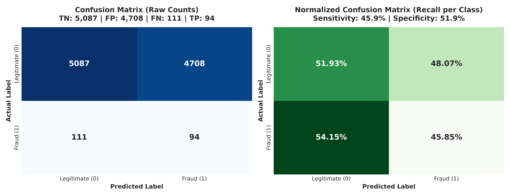
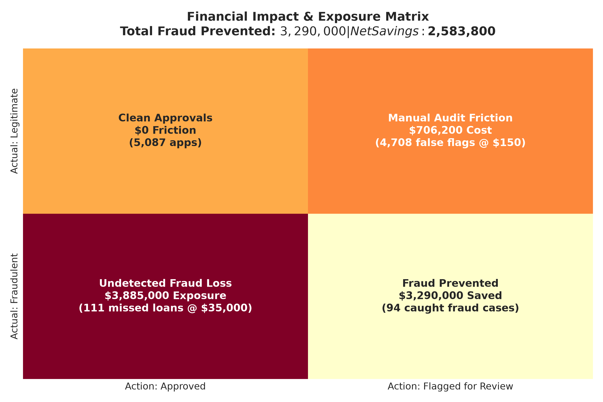
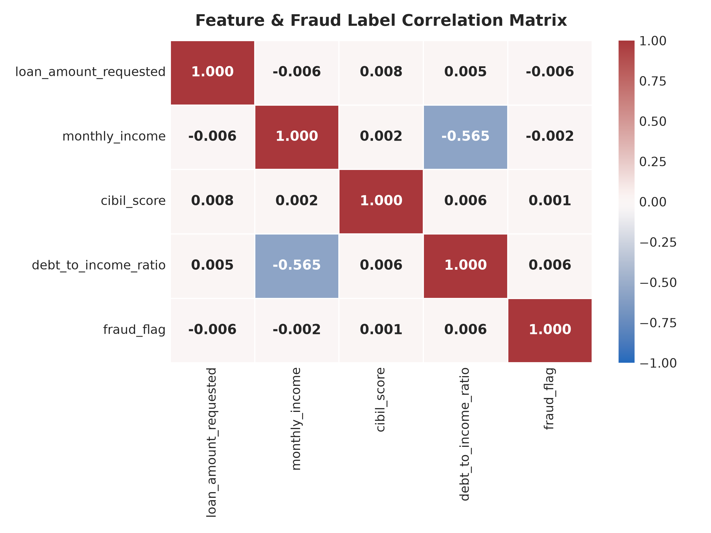
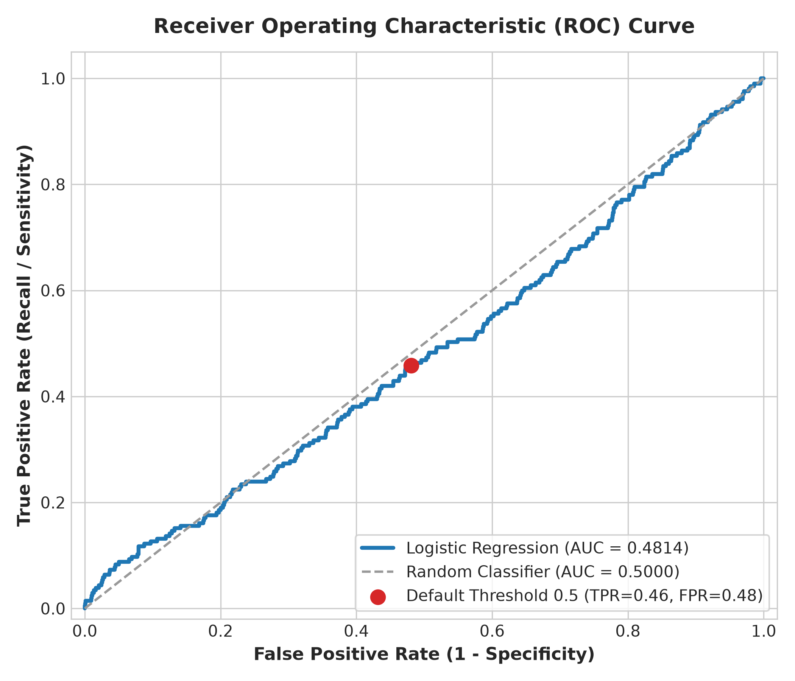
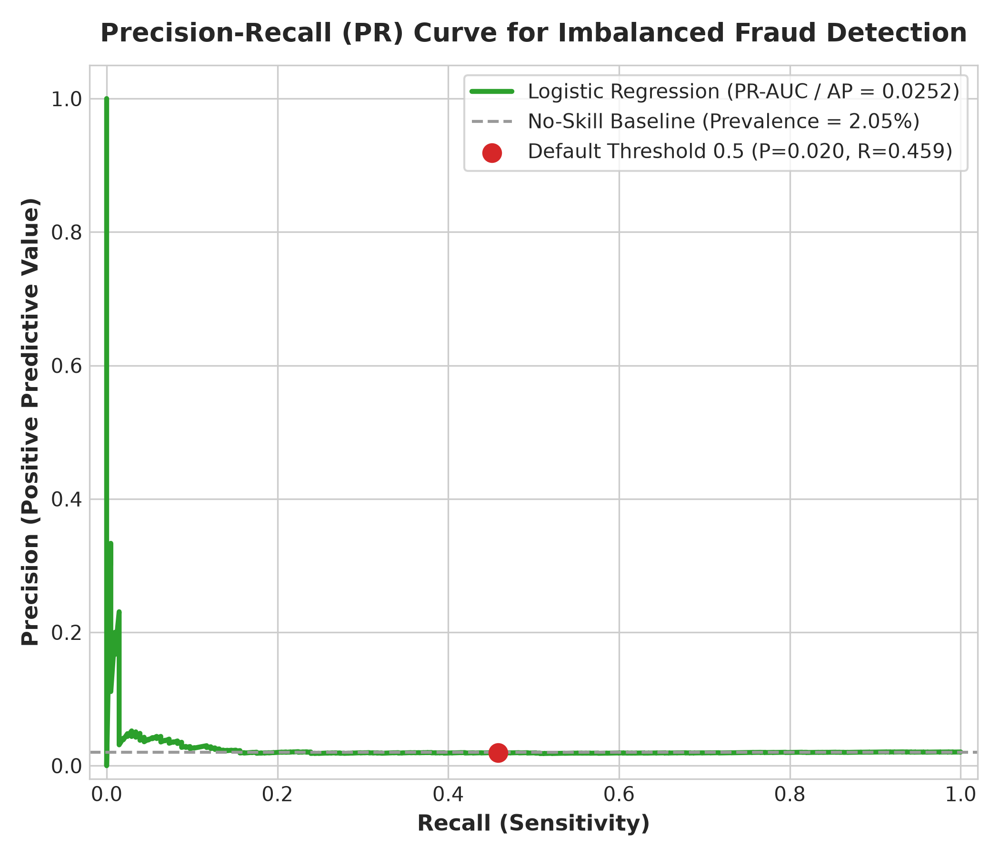
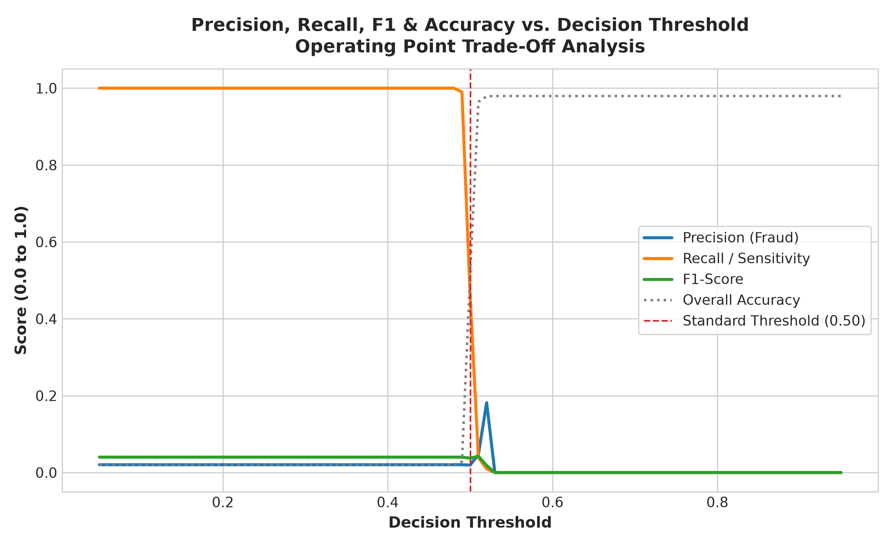
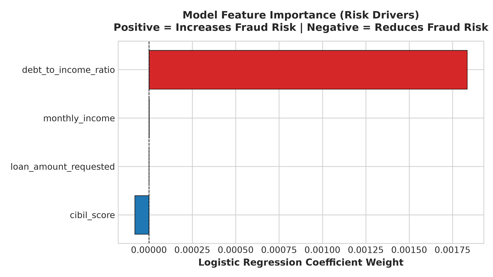
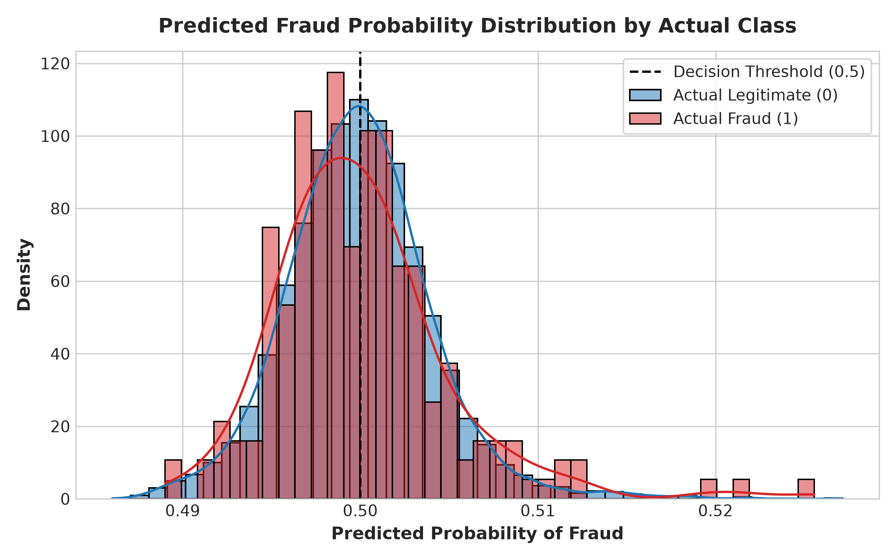
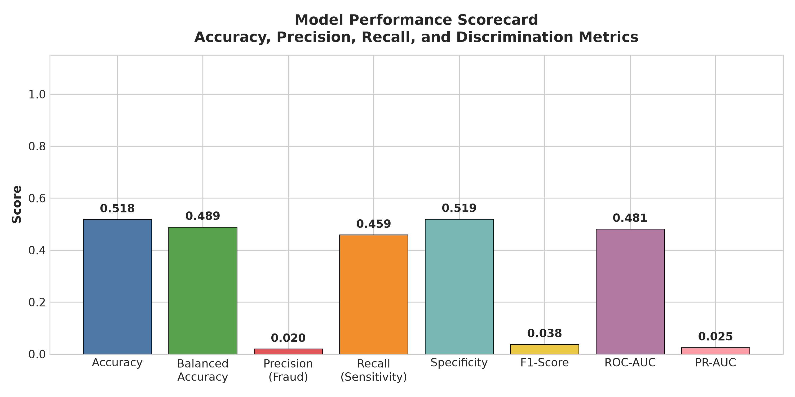

# 🛡️ Loan Fraud Detection - Model Evaluation & Performance Report

**Generated Date**: 2026-10-10 11:25:51  
**Model Architecture**: Logistic Regression (`class_weight='balanced'`, `max_iter=1000`)  
**Features Evaluated**: `loan_amount_requested, monthly_income, cibil_score, debt_to_income_ratio`  
**Target Label**: `fraud_flag` (0 = Legitimate, 1 = Fraud)  

---

## 1. Executive Summary & Headline Scorecard

In financial fraud detection, **class imbalance is severe** (fraud represents **2.05%** of all applications). Relying solely on raw **Accuracy** can be misleading, because a naive model that predicts every applicant is legitimate would achieve ~98% accuracy while capturing 0% of fraud.

For this reason, **Precision**, **Recall (Sensitivity)**, **PR-AUC**, and **Balanced Accuracy** serve as primary key performance indicators.

| Performance Metric | Score | Industry Interpretation |
| :--- | :---: | :--- |
| **Accuracy** | **0.5181** (51.8%) | Raw percentage of correct test decisions across both classes. |
| **Balanced Accuracy** | **0.4889** (48.9%) | Arithmetic mean of Sensitivity and Specificity; immune to class imbalance. |
| **Precision (Fraud Class)** | **0.0196** (2.0%) | Probability that an application flagged by the model is genuine fraud. |
| **Recall / Sensitivity** | **0.4585** (45.9%) | Percentage of all actual fraudsters successfully intercepted by the model. |
| **Specificity** | **0.5193** (51.9%) | Percentage of legitimate borrowers cleared without false accusations. |
| **F1-Score (Fraud)** | **0.0375** | Harmonic mean balancing fraud Precision and Recall. |
| **ROC-AUC Score** | **0.4814** | Area under Receiver Operating Characteristic curve. |
| **PR-AUC (Average Precision)** | **0.0252** | Area under Precision-Recall curve; key benchmark against baseline (2.05%). |
| **Matthews Correlation (MCC)** | **-0.0063** | Quality of binary classification considering all four confusion matrix quadrants. |
| **Cohen's Kappa** | **-0.0018** | Agreement between prediction and actual ground truth beyond random chance. |

---

## 2. Matrix Representations

### A. Confusion Matrix
The test partition contains **10,000** applications (**9,795** legitimate and **205** fraudulent).

| Category | Predicted Legitimate (0) | Predicted Fraud (1) | Total Actual |
| :--- | :---: | :---: | :---: |
| **Actual Legitimate (0)** | **5,087** (TN - True Negatives) | **4,708** (FP - False Alarms) | **9,795** |
| **Actual Fraud (1)** | **111** (FN - Missed Fraud) | **94** (TP - Caught Fraud) | **205** |
| **Total Predicted** | **5,198** | **4,802** | **10,000** |

### B. Financial Impact & Risk Cost Matrix
Translating confusion matrix quadrants into dollar exposure:
- **True Positives (94 loans)**: Successfully intercepted fraud prevented estimated **$3,290,000** in direct charge-off losses.
- **False Positives (4,708 loans)**: Legitimate borrowers flagged for secondary underwriting audit incurred **$706,200** in operational friction (@ $150/audit).
- **False Negatives (111 loans)**: Undetected fraud represents **$3,885,000** in capital loss exposure.
- **Net Fraud Mitigation Savings**: **$2,583,800** saved versus zero model intervention.

### C. Feature Correlation Matrix
Quantifying the linear relationship between applicant financial metrics and loan fraud:

---

## 3. Diagnostic Curves & Threshold Trade-Off Analysis

### ROC Curve & Precision-Recall Curve
- **ROC Curve**: Tracks the True Positive Rate against the False Positive Rate across all cutoffs.
- **Precision-Recall Curve**: Evaluates precision retention as recall expands.

| ROC Curve | Precision-Recall Curve |
| :---: | :---: |
|  |  |

### Decision Threshold Optimization
By adjusting the probability decision cutoff threshold, credit risk teams can calibrate the trade-off between **Precision** and **Recall**:

| Threshold | Accuracy | Precision (Fraud) | Recall (Sensitivity) | F1-Score | True Positives | False Positives |
| :---: | :---: | :---: | :---: | :---: | :---: | :---: |
| **0.10** | 0.0205 | 0.0205 | 1.0000 | 0.0402 | 205 | 9795 |
| **0.20** | 0.0205 | 0.0205 | 1.0000 | 0.0402 | 205 | 9795 |
| **0.30** | 0.0205 | 0.0205 | 1.0000 | 0.0402 | 205 | 9795 |
| **0.40** | 0.0205 | 0.0205 | 1.0000 | 0.0402 | 205 | 9795 |
| **0.50** | 0.5181 | 0.0196 | 0.4585 | 0.0375 | 94 | 4708 |
| **0.60** | 0.9795 | 0.0000 | 0.0000 | 0.0000 | 0 | 0 |
| **0.70** | 0.9795 | 0.0000 | 0.0000 | 0.0000 | 0 | 0 |
| **0.80** | 0.9795 | 0.0000 | 0.0000 | 0.0000 | 0 | 0 |
| **0.90** | 0.9795 | 0.0000 | 0.0000 | 0.0000 | 0 | 0 |

---

## 4. Key Feature Drivers & Probability Distribution

### Model Feature Coefficients (Risk Drivers)
The Logistic Regression weights reveal which factors trigger higher fraud probabilities:

- **Debt-to-Income Ratio (DTI)**: Coefficient `0.001834` — Higher DTI ratio strongly elevates loan vulnerability.
- **CIBIL / Credit Score**: Coefficient `-0.000082` — Lower credit scores correlate with increased risk.
- **Monthly Income & Loan Amount**: Secondary volume and leverage indicators.

### Probability Distribution
Comparison of model risk scores assigned to genuine applicants versus fraudulent applicants:

### Model Scorecard Summary

---

## 5. Artifacts Created in this Suite
All generated reports and high-resolution visuals are organized within this `report/` folder:
- 📊 [`confusion_matrix.png`](confusion_matrix.png)
- 💰 [`financial_cost_matrix.png`](financial_cost_matrix.png)
- 📈 [`roc_curve.png`](roc_curve.png)
- 🎯 [`precision_recall_curve.png`](precision_recall_curve.png)
- 🎚️ [`precision_recall_threshold_curve.png`](precision_recall_threshold_curve.png)
- 🔬 [`feature_importance.png`](feature_importance.png)
- 📉 [`prediction_probability_distribution.png`](prediction_probability_distribution.png)
- 🏆 [`metrics_comparison_barchart.png`](metrics_comparison_barchart.png)
- 📐 [`correlation_matrix.png`](correlation_matrix.png)
- 📏 [`calibration_curve.png`](calibration_curve.png)
- 📋 [`metrics_summary.json`](metrics_summary.json)
- 📑 [`metrics_summary.csv`](metrics_summary.csv)
- 📊 [`classification_report.csv`](classification_report.csv)
- 📄 [`classification_report.txt`](classification_report.txt)
- 🎛️ [`threshold_analysis.csv`](threshold_analysis.csv)
- 🔢 [`confusion_matrix.csv`](confusion_matrix.csv)
